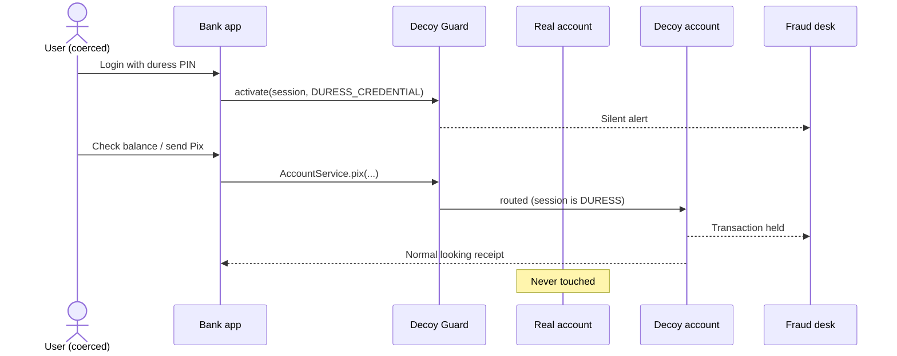

# Decoy Guard

Anti-coercion security layer for banking apps. A duress credential opens a convincing decoy session while real transactions are held and a silent alert is sent.

[](https://github.com/Valossa515/decoy-guard/actions/workflows/ci.yml)


> **Status:** early prototype for research and portfolio purposes. Not production ready.

## The problem

In Brazil, elderly people are a frequent target of scams where the victim is coerced, by phone or in person, into unlocking their bank app and showing the screen or making Pix transfers. Pix is instant and hard to reverse, and the attacker is watching every step, so the victim has no safe way to say no.

Most anti-fraud controls either block the transaction (which tells the attacker the victim resisted) or ask for more confirmation (which the attacker simply demands). Neither protects someone who is being watched.

## The idea

Give the user a way to **comply on screen without complying in reality**.

1. The user registers a **duress PIN** (or a duress fingerprint) next to their normal one.
2. Under coercion, they log in with it. The app looks and behaves exactly like a normal session.
3. Behind the scenes the session is served by a **decoy**: a small, believable balance and history.
4. Transfers show a normal receipt, but the money **never leaves the account**. The transaction is held for the fraud team.
5. A **silent alert** reaches the bank and, optionally, a trusted contact.



The guiding rule: **nothing the attacker can observe may differ between a real and a decoy session.** Same response shapes, same errors, same receipt format, comparable response times.

## How it works in code

Your controllers keep depending on an interface. You write a decoy implementation and mark it with `@Decoy`:

```java
public interface AccountService {
    Balance balance();
    PixReceipt pix(PixRequest request);
}

@Service
class RealAccountService implements AccountService { /* core banking */ }

@Decoy
@Service
class DecoyAccountService implements AccountService { /* believable fake */ }
```

The starter then:

* resolves the session mode once per request (`DuressContextFilter`) and binds it to the thread;
* wraps every real bean that has a decoy in a routing proxy, so calls go to the decoy only while the session is in duress;
* hides `@Decoy` beans from injection, so a decoy can never leak into a normal session, even with the starter disabled;
* exposes `DuressActivator`, which switches a session to duress and raises exactly one silent alert.

Switching a session at login:

```java
if (duressPinMatches) {
    duressActivator.activate(sessionToken, ActivationTrigger.DURESS_CREDENTIAL);
}
```

Every storage and alert component is an SPI with an in-memory default you are expected to replace:

| SPI | Default | Replace with |
|---|---|---|
| `DuressSessionRegistry` | in memory | Redis or database shared by all instances |
| `HeldTransactionStore` | in memory | durable store read by the fraud team |
| `SilentAlertPublisher` | application log | fraud queue, trusted contact notification |
| `SessionIdExtractor` | bearer token | JWT claim, session cookie |

## Modules

| Module | What it is |
|---|---|
| `decoy-guard-core` | Framework-agnostic model and SPIs (Java 21, no dependencies) |
| `decoy-guard-spring-boot-starter` | Auto-configuration, `@Decoy` routing, request filter |
| `decoy-guard-demo` | Fake bank API showing both sessions side by side |

## Try the demo

Requires Java 21 and Maven.

```bash
mvn verify
mvn -pl decoy-guard-demo spring-boot:run
```

Demo PINs: `1234` (real) and `4321` (duress).

```bash
# Log in with the duress PIN. The response looks exactly like a normal login.
TOKEN=$(curl -s localhost:8080/login -H 'Content-Type: application/json' \
  -d '{"pin":"4321"}' | sed 's/.*"token":"\([^"]*\)".*/\1/')

curl -s localhost:8080/account/balance -H "Authorization: Bearer $TOKEN"
# {"available":312.47}

curl -s localhost:8080/account/pix -H "Authorization: Bearer $TOKEN" \
  -H 'Content-Type: application/json' -d '{"key":"golpista@exemplo.com","amount":200}'
# {"endToEndId":"E...","status":"CONCLUIDO",...}   <- looks real, money never left

curl -s "localhost:8080/fraud-desk/held?session=$TOKEN"
# the held Pix, visible to the bank
```

Repeat with PIN `1234` to see the real account (balance 48,750.32).

## Documentation

* [Threat model](docs/threat-model.md): what this protects, what it does not, and why
* [FT-001 Duress session routing](.agent/plans/duress-session-routing.md): first spec (plan), with its [feature spec](.agent/specs/features/duress-session-routing.spec.toon) and [acceptance criteria](.agent/specs/acceptance/duress-session-routing.acceptance.toon)
* [Agent context](.agent/SKILLS.md): project context and conventions for AI coding agents, following [SDD](https://github.com/valossa515/sdd)

## Roadmap

- [x] Core model, SPIs and in-memory defaults
- [x] Spring Boot starter with `@Decoy` routing
- [x] Demo bank API with held Pix and fraud desk view
- [ ] Mobile-style web front end showing both sessions side by side
- [ ] Response time parity (decoy latency shaped like the real backend)
- [ ] Redis `DuressSessionRegistry` and JDBC `HeldTransactionStore`
- [ ] Risk signals: active phone call, screen mirroring, remote access apps (Android module)
- [ ] Trusted contact notification channel
- [ ] Publish to Maven Central under `io.github.valossa515`

## Em português

Camada de segurança anti-coação para apps bancários. Quando a pessoa é obrigada a abrir o app na frente de um golpista, ela entra com uma senha de coação. O app parece normal, mas mostra um saldo falso e pequeno, os Pix aparecem como concluídos sem o dinheiro sair da conta, e o banco recebe um alerta silencioso. O objetivo é proteger principalmente pessoas idosas, que são as vítimas mais frequentes desse tipo de golpe.

## License

[MIT](LICENSE) © Felipe Martins
